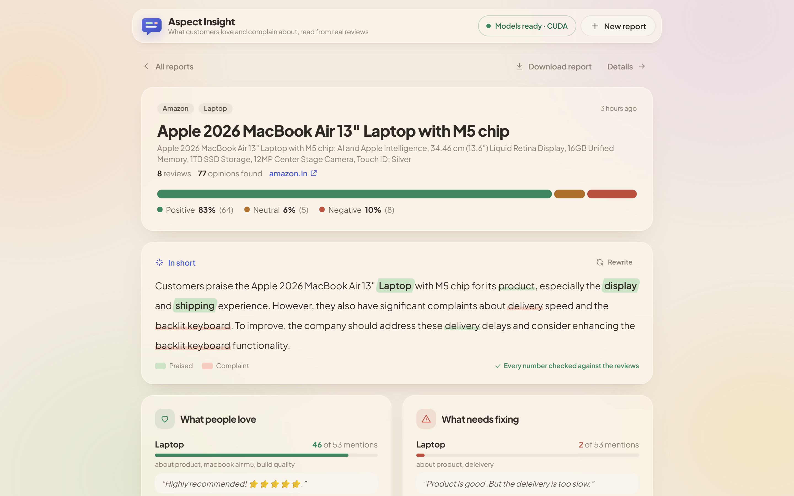
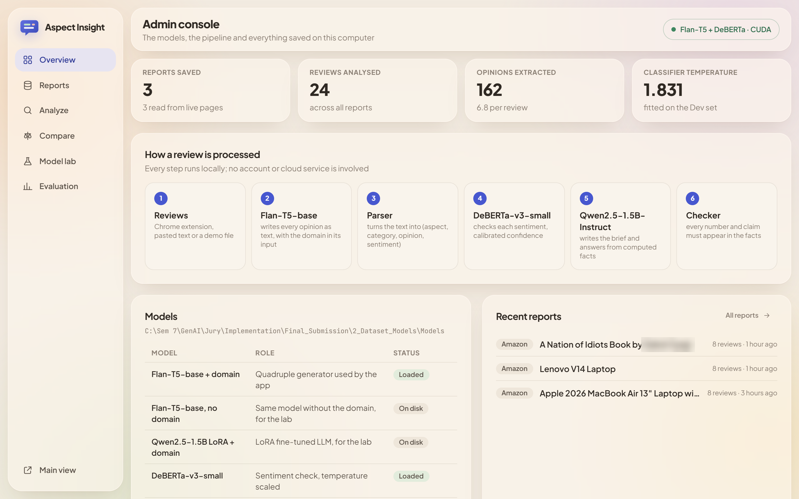
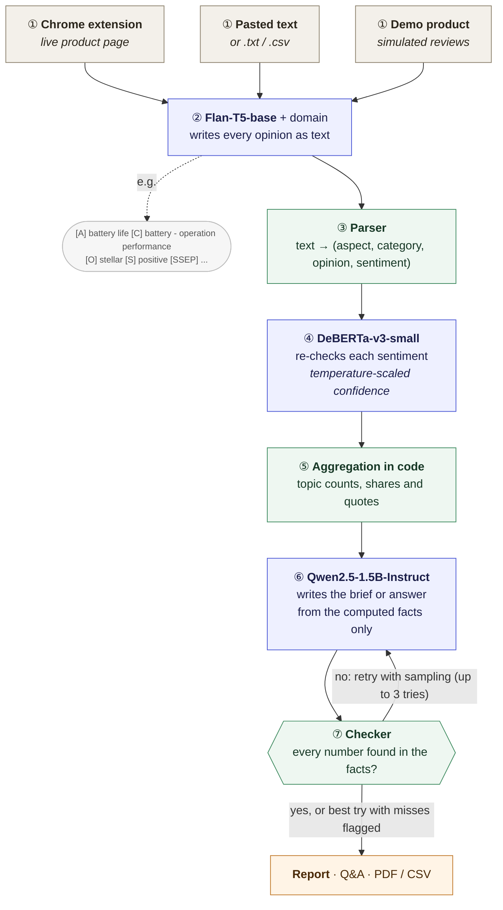

# Aspect Insight

**Generative aspect-based sentiment analysis on live customer reviews, running entirely on your own computer.**

Open a product, restaurant or hotel page in Chrome, click the Aspect Insight button, and every opinion in its reviews
is written out as an **(aspect, category, opinion, sentiment)** quadruple, grouped by topic, checked by a second model
and summarised in a few verified sentences. Nothing needs an account, an API key or a cloud service.

| Review | Aspect | Category | Opinion | Sentiment |
|---|---|---|---|---|
| *The battery life is stellar, but the plastic build feels cheap.* | battery life | Battery - operation performance | stellar | positive |
| | plastic build | Laptop - design features | cheap | negative |
| *It died after two hours.* | *(implicit)* | Battery - operation performance | died | negative |

The models are trained and evaluated on [MEMD-ABSA](https://github.com/NUSTM/MEMD-ABSA) (18,104 sentences, five domains:
books, clothing, hotels, laptops and restaurants).

<p>
  
  
</p>

## Highlights

- **Live reviews, not mock data.** A Chrome extension reads the reviews on the open page (Amazon, Flipkart, Zomato,
  Google Maps, Goodreads, Tripadvisor, Booking.com, or any page where you select review text), sends them to the local
  app and marks every aspect on the page itself in its sentiment colour.
- **Matches the published results.** One Flan-T5-base model that is told the review's domain is within 2.5 F1 points of
  the best published models on four of five domains (exact-match ACOS F1, mean of three seeds). Qwen2.5-1.5B with LoRA
  exceeds the best published Restaurant score.
- **A diagnosed and fixed failure.** Without the domain, 26 % of a single model's Laptop predictions used categories from
  other domains. Naming the domain in the input cut this to 0.4 % and raised Laptop ACOS F1 from 22.7 to 34.8.
- **Fine-tuning versus prompting.** Flan-T5 (49.7 ACOS F1, 35 ms per sentence) ties Qwen2.5-1.5B LoRA (50.2, not a
  significant difference) and beats prompting Qwen2.5-7B with five retrieved examples (30.4) by about 20 points.
- **Rare-class study.** Five ways of handling the rare Neutral class (2.2 % of opinions), with McNemar tests per seed
  and temperature scaling so that the confidences shown are calibrated.
- **Grounded generation.** The brief and the answers to questions are written by an LLM from facts computed in code.
  Every number, "X vs Y" pair and topic count in the text is checked against those facts before it is shown.
- **Downloadable report.** Any product's analysis can be saved as a plain, printable PDF: summary, sentiment split,
  findings by topic with quotes, category breakdown, method notes and every extracted opinion.

## The application

**Main view** (`http://127.0.0.1:8000`): one clean page per product.

| Part | What it shows |
|---|---|
| Reports | Every review set read so far, from the extension, pasted text or a demo product |
| Report | Sentiment split, a three-sentence brief with every number checked, what people love and what needs fixing (with quotes), a question box that answers from the reviews and cites them, and every review with its aspects highlighted. **Download report** saves it as a PDF |

**Admin console** (`http://127.0.0.1:8000/admin`): the depth behind each report.

| Section | What it does |
|---|---|
| Overview | The processing pipeline, the models and their status, recent reports |
| Reports | Categories chart, every extracted quadruple with the checker's verdict, timing, PDF report and CSV export, delete |
| Analyze | One review: quadruple table, calibrated confidence and the raw model input and output |
| Compare | Two products side by side, compared by the share of each side's reviews that praise or complain about a topic |
| Model lab | One sentence through several generators with greedy, beam-search or sampling decoding, optionally constrained |
| Evaluation | Test-set results, the comparison with the published results and the error analysis |

## How it works



<sub>Blue: neural models · Green: plain code · Qwen never reads the full set of reviews: it gets counts computed in code (plus up to 3 retrieved quotes when answering a question), so every figure it states can be checked.</sub>

| Component | Model | Training |
|---|---|---|
| Quadruple generator (used by the app) | Flan-T5-base, 248 M parameters | full fine-tuning, domain named in the input |
| Quadruple generator (compared) | Qwen2.5-1.5B-Instruct | LoRA, rank 16, 18.5 M trainable parameters |
| Prompting baseline | Qwen2.5-7B-Instruct | none: instruction, category list and 5 TF-IDF-retrieved examples |
| Sentiment check | DeBERTa-v3-small | class-weighted cross-entropy, temperature scaling |
| Brief and answers | Qwen2.5-1.5B-Instruct | none: phrases facts computed in code |

## Running it

Requirements: Python 3.10 or newer, Node.js 18 or newer (only to build the web app once), Google Chrome, and
optionally an NVIDIA GPU (a laptop GPU with 6 GB is enough; on CPU it is slower).

```bash
pip install -r requirements.txt
```

Then double-click **`Start.bat`** (or run `python -m uvicorn backend.app:app --host 127.0.0.1 --port 8000` from this
folder after `npm install && npm run build` in `frontend/`). The browser opens on `http://127.0.0.1:8000` once the models
have loaded.

**Trained weights.** The app looks for the four trained models in `ABSA_MODELS_DIR`, then in `models/` inside this
folder, then in `../2_Dataset_Models/Models/` next to it. Each model has its own folder: `Flan_T5_Domain`,
`Flan_T5_Plain`, `Qwen_LoRA_Domain` and `DeBERTa_Sentiment`. The base models (Flan-T5-base, DeBERTa-v3-small,
Qwen2.5-1.5B-Instruct) are downloaded from Hugging Face on the first start and cached.

**Chrome extension** (once):

1. Open `chrome://extensions` and turn on **Developer mode**.
2. Click **Load unpacked** and choose the `extension/` folder.
3. Open a product page, click the Aspect Insight icon and press **Read the reviews**. With **Load more reviews first**
   on (the default), it first scrolls the page, presses its "show more reviews" buttons, opens truncated reviews and, on
   Amazon, Flipkart (up to 5 pages) and Zomato (up to 15 pages), reads the next review pages in the background, up to
   100 reviews in all. Reading the same product or restaurant again (on Amazon, Flipkart, Zomato, Goodreads,
   Tripadvisor or Booking.com) updates its existing report instead of adding one.
   **Show on page** marks the aspects on the page; **Open full report** opens the report in the app.

Reports are saved in `data/captures.db` on this computer.

## Tests

```bash
python -m pytest        # 41 tests: data, metrics, parsing, summaries, number checks, captures and page matching
```

## Training and evaluation

The notebooks run the scripts on Google Colab. Copy this folder to Google Drive, open a notebook, set `PROJECT_DIR` in its
first cell, choose a GPU runtime and run all cells. Every script reads its settings from `configs/`, skips runs that
already have results, and accepts `--limit` and `--epochs` for quick smoke tests. Runs are written to `outputs/runs/`.

| Notebook | What it runs | Results in |
|---|---|---|
| `01_prepare_data` | `scripts/prepare_data.py` | `data/processed/` |
| `02_sentiment_classifiers` | five class-imbalance methods, three seeds | `outputs/results/classifiers/` |
| `03_t5_quad_generator` | Flan-T5 per domain, all domains, cross-domain, decoding strategies | `outputs/results/t5/` |
| `04_qwen_quad_generator` | Flan-T5 with the domain in the input, Qwen2.5-1.5B LoRA, prompting baselines | `outputs/results/t5/`, `qwen/`, `prompting/` |
| `05_neutral_augmentation` | LLM-generated Neutral data, with and without verification | `outputs/results/classifiers/` |

`scripts/evaluate_constrained.py` measures constrained decoding (Flan-T5 may only write categories of the given domain)
on the test set without any retraining; results are in `outputs/results/t5/constrained_decoding.md`.

## Project layout

| Path | Contents |
|---|---|
| `backend/` | FastAPI service (`app.py`) and the results collector for the Evaluation page |
| `frontend/src/main/` | Main view: reports list, new report, report page |
| `frontend/src/admin/` | Admin console sections |
| `frontend/src/components/` | Shared interface components |
| `extension/` | Chrome extension (side panel and page reader) |
| `src/absa/` | Data handling, models, metrics, inference, grounded text checks and the capture store |
| `scripts/` | Data preparation, training, evaluation and data generation |
| `configs/` | Experiment settings |
| `notebooks/` | Colab runners |
| `data/raw/MEMD-ABSA/` | Original dataset |
| `data/processed/` | Processed splits, category inventory and LLM-generated Neutral data |
| `data/demo/` | Simulated review files for trying the app without a live page |
| `outputs/results/` | Evaluation results |
| `tests/` | Unit and API tests |

## Demo data

`data/demo/` contains 307 **simulated** reviews in 19 CSV files, three or four well-known products per domain. They
describe only traits widely reported in public reviews. None of them is a real customer review; every row is marked as
simulated and the app labels these reports "Simulated reviews". Live pages are read with the extension.

## Dataset and references

- H. Cai, N. Song, Z. Wang, Q. Xie, Q. Zhao, K. Li, S. Wu, S. Liu, J. Yu and R. Xia. *MEMD-ABSA: A Multi-Element Multi-Domain Dataset for Aspect-Based Sentiment Analysis.* arXiv:2306.16956, 2023.
- H. W. Chung et al. *Scaling Instruction-Finetuned Language Models.* arXiv:2210.11416, 2022.
- E. J. Hu et al. *LoRA: Low-Rank Adaptation of Large Language Models.* ICLR, 2022.
- Qwen Team. *Qwen2.5 Technical Report.* arXiv:2412.15115, 2024.
- P. He, J. Gao and W. Chen. *DeBERTaV3.* ICLR, 2023.
- C. Guo, G. Pleiss, Y. Sun and K. Q. Weinberger. *On Calibration of Modern Neural Networks.* ICML, 2017.
